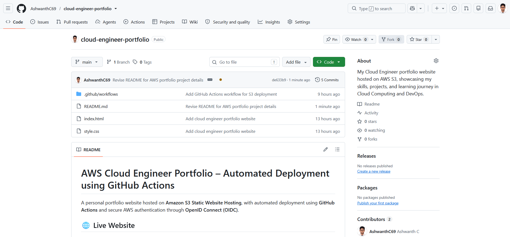
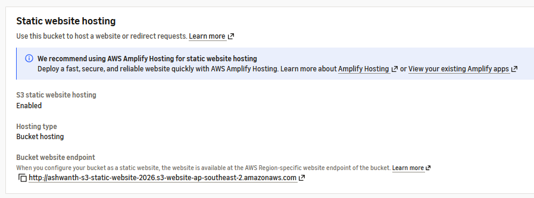
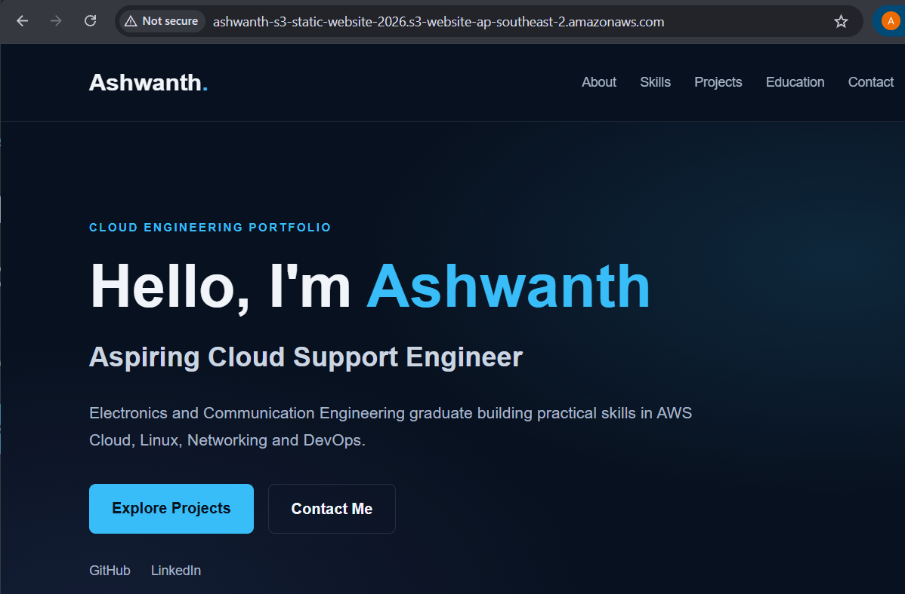
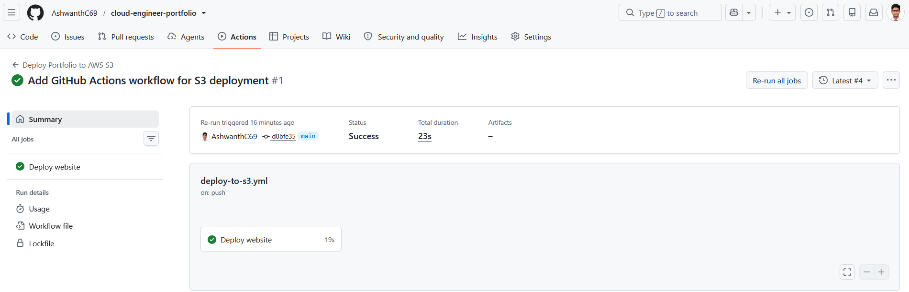
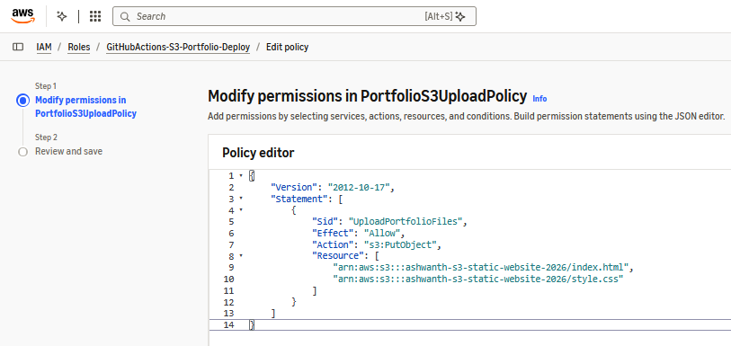

# AWS Cloud Engineer Portfolio – Automated Deployment using GitHub Actions

A personal portfolio website hosted on **Amazon S3 Static Website Hosting**, with automated deployment using **GitHub Actions** and secure AWS authentication through **OpenID Connect (OIDC)**.

## 🌐 Live Website

[Visit My Portfolio](http://ashwanth-s3-static-website-2026.s3-website-ap-southeast-2.amazonaws.com)

## 📌 Project Overview

This project demonstrates how to build, version-control, host, and automatically deploy a static website using AWS and DevOps tools.

Whenever changes are pushed to the `main` branch, GitHub Actions automatically authenticates with AWS and deploys the website files to an Amazon S3 bucket.

## 🏗️ Architecture

1. Develop and update website files locally.
2. Push changes to the GitHub repository.
3. GitHub Actions detects the push to the `main` branch.
4. GitHub Actions authenticates with AWS using OIDC.
5. The workflow uploads website files to Amazon S3.
6. The updated website becomes available through the S3 static website endpoint.

## 🛠️ Technologies Used

| Technology | Purpose |
|---|---|
| HTML5 | Website structure |
| CSS3 | Website styling |
| Amazon S3 | Static website hosting |
| AWS IAM | Access control and permissions |
| Git | Version control |
| GitHub | Source code repository |
| GitHub Actions | CI/CD automation |
| OpenID Connect (OIDC) | Secure authentication between GitHub Actions and AWS |

## ⚙️ AWS Configuration

- **AWS Service:** Amazon S3
- **Bucket:** `ashwanth-s3-static-website-2026`
- **Region:** `ap-southeast-2` (Sydney)
- **Hosting:** S3 Static Website Hosting
- **Default document:** `index.html`
- **Deployment:** Automated through GitHub Actions
- **Authentication:** AWS IAM role with GitHub OIDC

## 🔐 Security Implementation

- Configured an AWS IAM role for GitHub Actions.
- Integrated GitHub Actions with AWS using OpenID Connect.
- Avoided storing permanent AWS access keys in GitHub.
- Configured limited S3 upload permissions for website files.
- Stored the IAM role ARN in GitHub repository secrets.

## 🚀 CI/CD Pipeline

Workflow file: `.github/workflows/deploy-to-s3.yml`

**Trigger:** Push to the `main` branch.

**Pipeline Steps:**

1. Checkout repository.
2. Configure AWS credentials using OIDC.
3. Upload `index.html` and `style.css` to Amazon S3.

## 📂 Project Structure

```text
cloud-engineer-portfolio/
│
├── README.md
├── index.html
├── style.css
│
├── screenshots/
│   ├── 01-github-repository.png
│   ├── 02-s3-static-hosting.png
│   ├── 03-live-portfolio.png
│   ├── 04-github-actions-success.png
│   └── 05-iam-s3-permissions.png
│
└── .github/
    └── workflows/
        └── deploy-to-s3.yml
```text

## 📸 Project Screenshots

### 1. GitHub Repository


### 2. AWS S3 Static Website Hosting


### 3. Live Portfolio Website


### 4. Successful CI/CD Deployment


### 5. AWS IAM Permissions


## 📚 Key Learnings

Through this project, I gained practical experience in:

- Hosting a static website using Amazon S3.
- Managing source code using Git and GitHub.
- Creating a CI/CD workflow using GitHub Actions.
- Configuring AWS IAM roles and permissions.
- Integrating GitHub Actions with AWS using OIDC.
- Automating website deployment to AWS.

## 🔮 Future Improvements

- Add CloudFront for HTTPS and content delivery.
- Configure a custom domain.
- Explore automated testing in the CI/CD pipeline.
- Add monitoring and logging.

## 👨‍💻 Author

**Ashwanth C**

Aspiring Cloud Support Engineer | Cloud Computing | AWS | Linux | Networking | DevOps

- **GitHub:** [AshwanthC69](https://github.com/AshwanthC69)
- **LinkedIn:** [Ashwanth C](https://www.linkedin.com/in/ashwanth-c-59439925a/)
- **Email:** ashwanthchandran@gmail.com

---

⭐ If you find this project useful, feel free to explore the repository.
